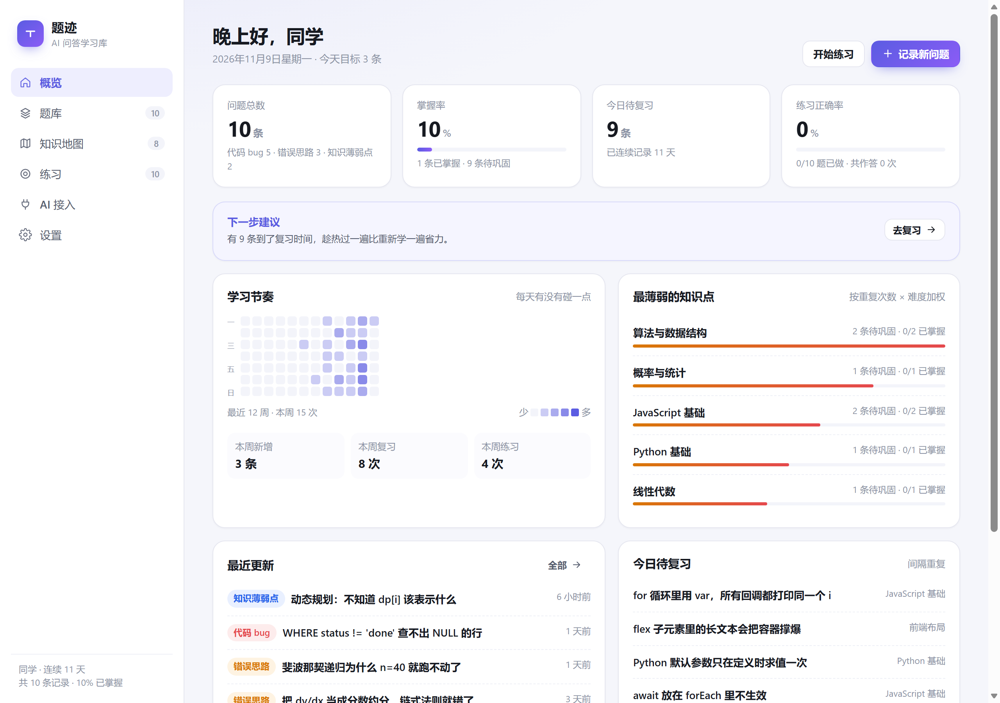

# 题迹 · Tiji

**A local-first learning log for the questions you asked AI.**
Every question becomes a Markdown file; every file becomes a lesson you can review.

[](LICENSE)




> The interface is in Chinese. The data format is plain Markdown, so everything else is language-agnostic.

---

## The problem

You ask ChatGPT why your code breaks. It explains. You nod. Three weeks later you hit the same bug and remember nothing.

Notes don't fix this, because most notes record **the answer**. What you actually need is a record of **the wrong idea you had** — that's what lets you stop at the same fork in the road next time.

Tiji turns Q&A into that record, and adds the machinery to keep it alive: weak-topic detection, spaced repetition, and practice questions.

Each entry holds:

| Field | Why it exists |
| --- | --- |
| **The question** | what you actually asked, in your own words |
| **Your attempt** | the wrong idea you had — the most valuable field |
| **Root cause** | the mechanism, not the symptom |
| **Fix** | the correct approach |
| **Takeaway** | one line: what to think of next time |
| **Before / after code** | side-by-side, so you can see the delta |

## Why files instead of a database?

Because the second user of this app is an AI.

Content lives in `content/` — one Markdown file per entry. That means an agent (ChatGPT Work, Claude Code, Cursor, a shell script) can just **create or edit files**. No API, no schema migration, no sync layer.

- **Save a file → the page updates within a second** (the server watches the folder).
- **The filename is the identity** — rewriting the same file updates the entry instead of duplicating it.
- **`git` works out of the box** — every AI edit is a diff you can review and roll back.
- **Nothing leaves your machine.**

## Quick start

Requires **Node.js 18+**. There are no dependencies and no build step.

```bash
git clone https://github.com/<you>/tiji.git
cd tiji
npm start          # or: node server.js --open
```

- **Windows**: double-click `start.cmd`
- **macOS / Linux**: `./start.sh`

Then open <http://127.0.0.1:4321>. The first run seeds ten demo entries so the app isn't empty.

## What's inside

| Page | What it does |
| --- | --- |
| **Overview** | mastery rate, due-for-review, 12-week activity heatmap, weakest topics (weighted by repeat count × difficulty) |
| **Entries** | search and filter; the detail drawer shows question → wrong attempt → root cause → fix → code diff |
| **Knowledge map** | per-topic summary, key points, common pitfalls, progress |
| **Practice** | hint / reveal answer; answering feeds the review schedule |
| **AI access** | folder path, format sample, a ready-to-paste prompt, Markdown import |
| **Settings** | profile, dark mode, export, restore demo data |

## The file format

`content/entries/<id>.md`:

```markdown
---
title: Python mutable default arguments are evaluated once
type: bug
topic: Python basics
tags: [python, functions]
difficulty: 2
status: learning
---

# Python mutable default arguments are evaluated once

## question
Second call still has the previous items in the list.

## attempt
I thought it was global variable pollution.

## cause
`[]` is created once at function definition time and shared by every call.

## solution
Use `None` as the sentinel and create the list inside the function.

## takeaway
When you see a default value, ask: when is it evaluated, and who shares it?

## code_before
```python
def collect(x, acc=[]):
    acc.append(x)
    return acc
```
```

Headings can be English (`question`, `attempt`, `cause`, `solution`, `takeaway`) or Chinese (`原始问题`, `当时的思路`, `错因`, `解法`, `心法`); the app writes the Chinese ones. Unknown sections are kept as-is instead of being dropped. Full spec, including topics and practice files: **[AGENTS.md](AGENTS.md)** (written for an AI, readable by humans).

```text
content/
├─ entries/     one file per question
├─ topics/      one file per subject summary
├─ practice/    one file per exercise
├─ site.json    profile
└─ .state/      review schedule and attempt history (machine-managed)
```

## Let an AI maintain it

1. Open the **AI access** page and copy the prompt under "3 · 把这段话发给 ChatGPT".
2. Give it to your agent together with the conversation you want archived.

The prompt states the folder, the exact format, the four `type` values, and the rule "don't touch `.state/`". If the agent cannot write to the filesystem, paste its Markdown output into the import box — it lands as the same `.md` file.

## Optional HTTP API

Only needed for automation. Full machine-readable contract: `GET /api`.

| Method | Path | Purpose |
| --- | --- | --- |
| GET | `/api/snapshot` | everything at once |
| GET | `/api/entries?q=&topic=&type=` | search |
| POST | `/api/entries` | create (JSON) |
| POST | `/api/entries/raw` | create from a Markdown blob |
| PATCH | `/api/entries/:id` | partial update |
| POST | `/api/entries/:id/review` | record a review `{grade: 0-5}` |
| POST | `/api/practice/:id/attempt` | record an answer |
| POST | `/api/import` | bulk `{entries, topics, practice}` |
| GET | `/api/stats` | statistics |

Writes require `Authorization: Bearer <token>` — the token is in `config.json`. Reading and editing files directly needs no token at all.

## Configuration

`config.json` is generated on first run and git-ignored:

```json
{ "port": 4321, "host": "127.0.0.1", "token": "…" }
```

Change `host` to `0.0.0.0` only if you understand that anyone who can reach the port can write your data — replace the token first.

## FAQ

**The page won't open.** The server isn't running. Double-click `start.cmd` (Windows) and leave the window open; it's a local process, not a service.

**Port already in use.** Edit `port` in `config.json`, restart.

**Where is my data?** In `content/`. Back up by copying the folder; `git init` in the project root if you want history.

**Multiple machines?** Put `content/` in a private git repo and sync it, or keep the folder in a cloud drive.

**Start automatically on Windows.** Double-click `autostart-on.cmd` (runs minimized at login); `autostart-off.cmd` removes it.

## Development

```bash
npm test           # node --test, no test dependencies
```

```
server.js          HTTP server, static files, file watcher, SSE
src/filestore.js   folder ⇄ records
src/markdown.js    Markdown parse / serialize
src/api.js         optional REST API
src/stats.js       statistics, weak topics, heatmap
src/seed.js        demo data
public/            vanilla HTML/CSS/JS frontend
```

Environment overrides (used by the test suite): `TIJI_PORT`, `TIJI_HOST`, `TIJI_CONTENT_DIR`, `TIJI_CONFIG`.

## License

[MIT](LICENSE) © Tiji contributors

中文说明见 **[README.md](README.md)**。
