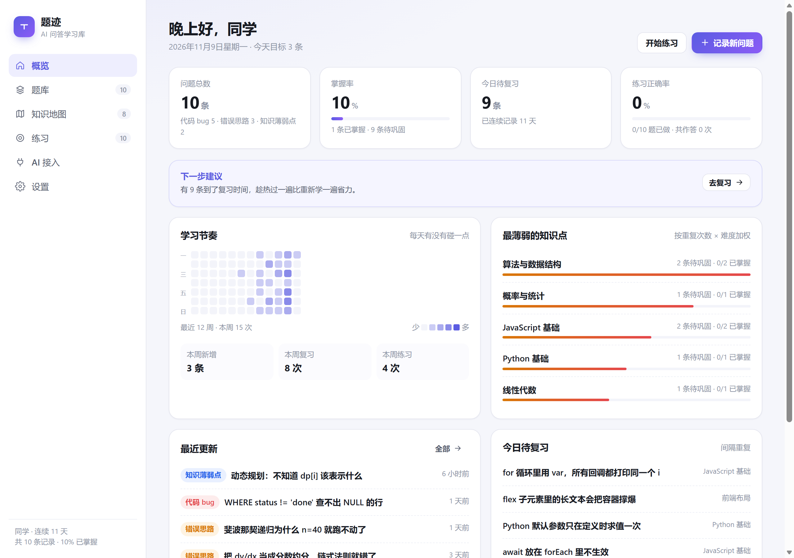
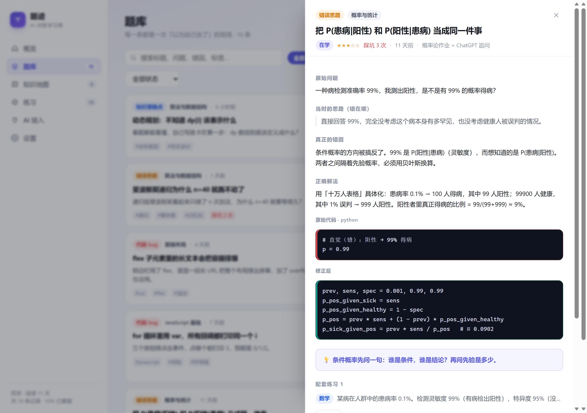
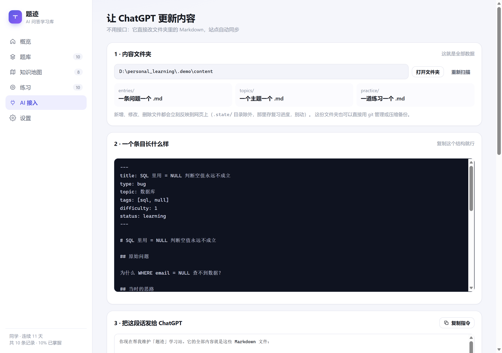

# 题迹 · Tiji

**把「问过 AI 的问题」变成能反复复习的笔记。**
一条记录 = 一个 Markdown 文件，内容全在你自己的硬盘上。

[](LICENSE)




English: **[README.en.md](README.en.md)**

---

## 它解决什么

你问 ChatGPT 为什么这段代码报错，它解释得很清楚，你点头，三周后同一个坑再踩一次。

普通笔记救不了这个问题——因为它们记的是**答案**。真正有用的是记下**你当时错在哪**，下次走到同一个岔路口才会停下来。

题迹把一次问答拆成结构化的一条记录：

| 字段 | 为什么要有 |
| --- | --- |
| 原始问题 | 你当时到底在问什么，用自己的话 |
| 当时的思路 | 你错误地以为是什么——**最有价值的一栏** |
| 错因 | 机制层面的原因，不是现象复述 |
| 解法 | 正确做法 |
| 心法 | 一句话：下次第一反应该想到什么 |
| 前后代码 | 错误写法与修正写法并排 |

再加上：掌握率、12 周学习热力图、**最薄弱知识点**（按重复踩坑次数 × 难度加权）、间隔重复复习、配套练习。

## 为什么是文件，不是数据库

因为这个应用的第二个用户是 AI。

内容都在 `content/` 目录，一条记录一个 `.md` 文件。这意味着 ChatGPT Work、Claude Code、Cursor、随便一个脚本，**直接读写文件就够了**：

- 保存文件 → 网页 1 秒内自动更新（服务在监听目录）；
- **文件名就是 ID**，重写同一个文件是更新，不会刷出重复条目；
- `git` 直接可用，AI 的每次改动都是一个可 diff、可回滚的提交；
- 数据不出本机。

## 快速开始

需要 **Node.js 18+**。没有依赖，没有构建步骤。

```bash
git clone https://github.com/<you>/tiji.git
cd tiji
npm start          # 或 node server.js --open
```

- **Windows**：双击 `start.cmd`
- **macOS / Linux**：`./start.sh`

打开 <http://127.0.0.1:4321>。首次启动会写入 10 条示例数据，方便你看清长什么样，在「设置」里可以一键清空。

## 界面

| 页面 | 作用 |
| --- | --- |
| **概览** | 掌握率、今日待复习、12 周热力图、最薄弱知识点 |
| **题库** | 搜索筛选；详情里是 问题 → 错误思路 → 错因 → 解法 → 代码对比 |
| **知识地图** | 每个主题的总结、要点、常见坑、掌握进度 |
| **练习** | 看提示 / 看答案，作答结果自动影响对应条目的复习间隔 |
| **AI 接入** | 文件夹位置、格式样例、可直接复制的指令、Markdown 导入 |
| **设置** | 资料、深色模式、导出、恢复示例数据 |



## 文件格式

`content/entries/<id>.md`：

```markdown
---
title: Python 默认参数只在定义时求值一次
type: bug
topic: Python 基础
tags: [python, 函数]
difficulty: 2
status: learning
---

# Python 默认参数只在定义时求值一次

## 原始问题
第二次调用时列表里还留着上次的元素。

## 当时的思路
以为是全局变量污染。

## 错因
`[]` 在函数定义时只创建一次，所有调用共享同一个对象。

## 解法
默认值用 `None` 占位，函数体内再创建。

## 心法
看到默认值先问：它什么时候求值？谁和谁共享？
```

小节标题中英文都认（`question` / `attempt` / `cause` / `solution` / `takeaway`，或 `原始问题` / `当时的思路` / `错因` / `解法` / `心法`），认不出的段落会原样保留，不会丢。完整规范见 **[AGENTS.md](AGENTS.md)**。

```text
content/
├─ entries/     一条问题一个文件
├─ topics/      一个主题一个文件
├─ practice/    一道练习一个文件
├─ site.json    个人资料
└─ .state/      复习进度（程序维护，别手改）
```

## 让 AI 维护它

1. 打开网页「AI 接入」页，复制第 3 节的指令；
2. 连同你想归档的那段对话，一起发给你的 AI。

指令里写清了目录、格式、四种 `type` 的含义，以及「不要动 `.state/`」。如果它不能读写文件，就让它按格式输出 Markdown，粘贴到第 4 节的导入框——落地的还是同一个 `.md`。



## 可选接口

只有做自动化时才需要。完整契约：`GET /api`。

| 方法 | 路径 | 说明 |
| --- | --- | --- |
| GET | `/api/snapshot` | 一次取回全部数据 |
| GET | `/api/entries?q=&topic=&type=` | 检索 |
| POST | `/api/entries` | 新建（JSON） |
| POST | `/api/entries/raw` | 传一段 Markdown 直接入库 |
| PATCH | `/api/entries/:id` | 局部更新 |
| POST | `/api/entries/:id/review` | 记录复习评分 |
| POST | `/api/practice/:id/attempt` | 记录作答 |
| POST | `/api/import` | 批量导入 |
| GET | `/api/stats` | 统计 |

写操作需要 `Authorization: Bearer <token>`（令牌在 `config.json`）。直接改文件则完全不需要。

## 配置

首次启动生成 `config.json`（已 git 忽略）：

```json
{ "port": 4321, "host": "127.0.0.1", "token": "…" }
```

把 `host` 改成 `0.0.0.0` 前请先换一个强随机 token——能访问这个端口的人就能改你的数据。

## 常见问题

**网页打不开。** 服务没在跑。Windows 双击 `start.cmd`，**窗口不要关**——它是本地进程，不是系统服务。

**双击后报 `Cannot find module ... server.js`。** 你把 `start.cmd` 单独复制到别处了。它必须和 `server.js` 待在同一个文件夹里；想在桌面放一个入口，就建一个指向 `start.cmd` 的快捷方式（起始位置设为项目目录），而不是复制文件本身。

**端口被占用。** 改 `config.json` 里的 `port`，重启。

**数据在哪？** 全在 `content/`。备份就是复制这个文件夹；想要历史记录就在项目根目录 `git init`。

**想多设备同步？** 把 `content/` 单独放进一个私有 git 仓库，或放网盘同步。

**Windows 开机自启。** 双击 `autostart-on.cmd`（登录后最小化启动，不弹浏览器），`autostart-off.cmd` 取消。

## 开发

```bash
npm test           # node --test，没有测试依赖
```

```
server.js          HTTP 服务、静态文件、目录监听、SSE 推送
src/filestore.js   文件夹 ⇄ 记录
src/markdown.js    Markdown 解析 / 序列化
src/api.js         可选的 REST API
src/stats.js       统计、薄弱点、热力图
src/seed.js        示例数据
public/            原生 HTML/CSS/JS 前端
```

测试用到的环境变量：`TIJI_PORT`、`TIJI_HOST`、`TIJI_CONTENT_DIR`、`TIJI_CONFIG`。

## 许可证

[MIT](LICENSE) © Tiji contributors
